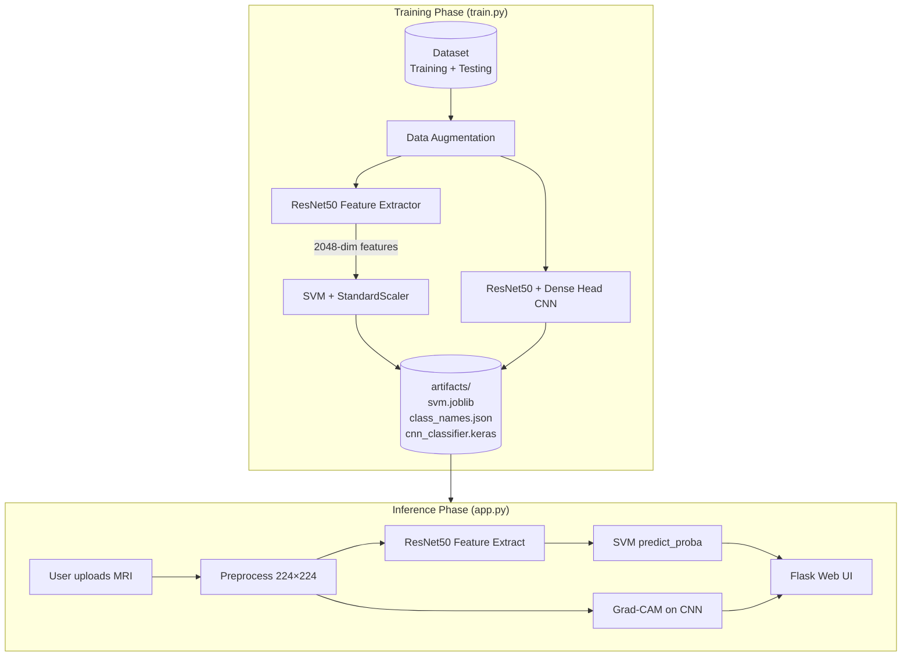

# Brain Tumor MRI Detection — Complete Project Documentation

> **Purpose of this document:** A full, reviewer-ready explanation of every segment, module, algorithm, design decision, and execution step in this project. Nothing omitted.

---

## Table of Contents

1. [Project Overview](#1-project-overview)
2. [High-Level System Architecture](#2-high-level-system-architecture)
3. [Project Structure (Every Segment)](#3-project-structure-every-segment)
4. [Modules and Libraries Used](#4-modules-and-libraries-used)
5. [Dataset Segment](#5-dataset-segment)
6. [File-by-File Explanation](#6-file-by-file-explanation)
   - 6.1 [ml_utils.py — Shared Utilities](#61-ml_utilspy--shared-utilities)
   - 6.2 [train.py — Training Pipeline (3 Stages)](#62-trainpy--training-pipeline-3-stages)
   - 6.3 [gradcam.py — Explainability (Grad-CAM Algorithm)](#63-gradcampy--explainability-grad-cam-algorithm)
   - 6.4 [app.py — Flask Web Application](#64-apppy--flask-web-application)
   - 6.5 [templates/index.html — Frontend UI](#65-templatesindexhtml--frontend-ui)
   - 6.6 [requirements.txt — Dependencies](#66-requirementstxt--dependencies)
   - 6.7 [artifacts/ — Saved Model Outputs](#67-artifacts--saved-model-outputs)
7. [Algorithms Summary (Reviewer Cheat Sheet)](#7-algorithms-summary-reviewer-cheat-sheet)
8. [Design Rationale (Why This Hybrid Design?)](#8-design-rationale-why-this-hybrid-design)
9. [How to Run (Execution Flow)](#9-how-to-run-execution-flow)
10. [Key Hyperparameters](#10-key-hyperparameters)
11. [Training Pipeline — Step-by-Step Internal Flow](#11-training-pipeline--step-by-step-internal-flow)
12. [Inference Pipeline — Step-by-Step Internal Flow](#12-inference-pipeline--step-by-step-internal-flow)
13. [Grad-CAM Algorithm — Mathematical Breakdown](#13-grad-cam-algorithm--mathematical-breakdown)
14. [ResNet50 Architecture — What It Does Here](#14-resnet50-architecture--what-it-does-here)
15. [SVM Algorithm — What It Does Here](#15-svm-algorithm--what-it-does-here)
16. [Data Augmentation Details](#16-data-augmentation-details)
17. [Preprocessing Details](#17-preprocessing-details)
18. [Web Application — Request/Response Flow](#18-web-application--requestresponse-flow)
19. [Error Handling](#19-error-handling)
20. [Limitations (Honest Points for Reviewer)](#20-limitations-honest-points-for-reviewer)
21. [One-Paragraph Elevator Pitch (For Viva / Presentation)](#21-one-paragraph-elevator-pitch-for-viva--presentation)
22. [Possible Reviewer Questions and Answers](#22-possible-reviewer-questions-and-answers)

---

## 1. Project Overview

**Project Title:** Brain Tumor MRI Detection using Hybrid Deep Learning + Machine Learning

**Full Technical Stack Label:** ResNet50 (CNN) + SVM + Grad-CAM + Flask

**Goal:** Automatically classify brain MRI scans into four medical categories.

### Classification Classes

| Class | Meaning |
|-------|---------|
| `glioma` | Malignant tumor arising from glial cells (supportive tissue of the brain) |
| `meningioma` | Tumor that forms in the meninges (membranes surrounding brain and spinal cord) |
| `pituitary` | Tumor in the pituitary gland (hormone-regulating gland at base of brain) |
| `notumor` | Healthy brain scan with no tumor detected |

**Saved class order in `artifacts/class_names.json`:**
```json
["glioma", "meningioma", "notumor", "pituitary"]
```

### Core Approach — Hybrid Two-Stage Pipeline

This project deliberately combines **deep learning** and **classical machine learning**:

| Stage | Technology | Role |
|-------|------------|------|
| **Stage 1** | ResNet50 (CNN) | Feature extraction — converts MRI image into a 2048-dimensional numerical feature vector |
| **Stage 2** | SVM (Support Vector Machine) | Classification — maps feature vector to one of four tumor categories |
| **Stage 3** | Grad-CAM | Explainability — generates a heatmap showing which brain regions influenced the prediction |
| **Deployment** | Flask Web App | Real-time user interface for uploading MRI and viewing results |

**Why hybrid?** Deep CNNs excel at learning visual representations from images. SVMs are powerful classical classifiers that work very well on fixed-length feature vectors. Combining them gives strong accuracy with faster training and smaller model artifacts than a full end-to-end deep classifier.

---

## 2. High-Level System Architecture



### Two Parallel Model Paths

| Path | Model | Used For |
|------|-------|----------|
| **Classification path** | ResNet50 (frozen) → SVM Pipeline | Final prediction label, confidence, class probabilities |
| **Explainability path** | ResNet50 + Dense Head CNN | Grad-CAM heatmap generation only |

> **Important:** The CNN classifier head is **not** used for the final prediction in the web app. Only the SVM produces the diagnosis. The CNN exists because Grad-CAM requires spatial convolutional feature maps, which the pooled SVM feature vector does not preserve.

---

## 3. Project Structure (Every Segment)

```
projectPhase1/
│
├── dataset/                          # Raw MRI image dataset
│   ├── Training/                     # Training set (5,600 images total)
│   │   ├── glioma/                   # 1,400 images
│   │   ├── meningioma/               # 1,400 images
│   │   ├── notumor/                  # 1,400 images
│   │   └── pituitary/                # 1,400 images
│   └── Testing/                      # Test set (1,600 images total)
│       ├── glioma/                   # 400 images
│       ├── meningioma/               # 400 images
│       ├── notumor/                  # 400 images
│       └── pituitary/                # 400 images
│
├── artifacts/                        # Generated after running train.py
│   ├── svm.joblib                    # Saved sklearn Pipeline (StandardScaler + SVM)
│   ├── class_names.json              # List of 4 class label strings
│   └── cnn_classifier.keras        # Keras model for Grad-CAM only
│
├── templates/                        # Flask HTML templates
│   └── index.html                    # Web UI (upload form + results display)
│
├── train.py                          # Full training pipeline (3 stages)
├── app.py                            # Flask web server + live inference
├── ml_utils.py                       # Shared helper functions (I/O, JSON, images)
├── gradcam.py                        # Grad-CAM heatmap generation + overlay
│
├── requirements.txt                  # Python package dependencies
├── README.md                         # Quick setup and run instructions
├── how to run.txt                    # Windows-specific run commands
└── PROJECT_DOCUMENTATION.md          # This file — full project explanation
```

### Segment Roles at a Glance

| Segment | Type | Purpose |
|---------|------|---------|
| `dataset/` | Data | Stores all MRI images organized by class label folders |
| `artifacts/` | Model storage | Persists trained models so `app.py` can load them without retraining |
| `train.py` | Training script | Runs all 3 training stages and writes artifacts |
| `app.py` | Web server | Serves UI, accepts uploads, runs inference, returns results |
| `ml_utils.py` | Utility module | Reusable helpers for directories, JSON, image loading |
| `gradcam.py` | XAI module | Implements Grad-CAM algorithm and heatmap visualization |
| `templates/index.html` | Frontend | User-facing web interface |
| `requirements.txt` | Config | Lists all Python libraries and minimum versions |

---

## 4. Modules and Libraries Used

### Python Dependencies (`requirements.txt`)

| Module / Library | Minimum Version | Role in This Project |
|------------------|-----------------|----------------------|
| **TensorFlow** | ≥ 2.15 | Deep learning framework; ResNet50 model, training loops, GradientTape for Grad-CAM |
| **Keras** (bundled with TensorFlow) | (via TF) | High-level API for building/training neural networks |
| **scikit-learn** | ≥ 1.4 | SVM classifier (`SVC`), `StandardScaler`, `Pipeline`, accuracy scoring |
| **NumPy** | ≥ 1.26 | Numerical arrays for features, images, probabilities, heatmaps |
| **Pillow (PIL)** | ≥ 10.2 | Load MRI images, convert to RGB, resize, save as PNG for Base64 encoding |
| **OpenCV (cv2)** | ≥ 4.9 | Resize heatmap, apply JET colormap, convert BGR→RGB, alpha-blend overlay |
| **Matplotlib** | ≥ 3.8 | Listed in requirements; available for plotting (not used in core scripts) |
| **Flask** | ≥ 3.0 | Web server framework; routes, request handling, Jinja2 template rendering |
| **joblib** | ≥ 1.3 | Serialize (save) and deserialize (load) the trained SVM Pipeline to/from disk |

### Built-in Python Modules Used

| Module | Used In | Purpose |
|--------|---------|---------|
| `argparse` | `train.py` | Command-line arguments (`--quick`, `--epochs`, batch limits) |
| `os` | `train.py` | Suppress TensorFlow C++ log noise (`TF_CPP_MIN_LOG_LEVEL`) |
| `pathlib.Path` | `train.py`, `app.py`, `ml_utils.py` | Cross-platform file/directory path handling |
| `json` | `ml_utils.py` | Read/write `class_names.json` |
| `base64` | `app.py` | Encode result images as Base64 strings for HTML embedding |
| `io.BytesIO` | `app.py` | In-memory buffer for PNG encoding without writing temp files |
| `typing` | `ml_utils.py`, `train.py`, `app.py`, `gradcam.py` | Type hints for code clarity |

### Pre-trained Weights

- **ResNet50** uses **ImageNet** pre-trained weights (`weights="imagenet"`)
- ImageNet: 1.2 million natural images, 1000 classes
- This is **transfer learning** — leveraging visual features learned on general images and applying them to medical MRI scans

### Implicit / Transitive Dependencies

| Library | Comes From | Role |
|---------|------------|------|
| **Werkzeug** | Flask | WSGI utilities, file upload handling |
| **Jinja2** | Flask | HTML template engine (`render_template`) |
| **h5py** | TensorFlow/Keras | Saving/loading `.keras` model files |
| **SciPy** | scikit-learn | Scientific computing backend for sklearn |

---

## 5. Dataset Segment

### Source

**Kaggle Brain Tumor MRI Dataset** — a publicly available, folder-structured image classification dataset of brain MRI scans.

### Directory Layout Required

```
dataset/
  Training/
    <class_name_1>/
      image1.jpg
      image2.jpg
      ...
    <class_name_2>/
      ...
  Testing/
    <class_name_1>/
      ...
    <class_name_2>/
      ...
```

### Actual Dataset Statistics in This Project

| Split | Class | Image Count |
|-------|-------|-------------|
| Training | glioma | 1,400 |
| Training | meningioma | 1,400 |
| Training | notumor | 1,400 |
| Training | pituitary | 1,400 |
| **Training Total** | | **5,600** |
| Testing | glioma | 400 |
| Testing | meningioma | 400 |
| Testing | notumor | 400 |
| Testing | pituitary | 400 |
| **Testing Total** | | **1,600** |
| **Grand Total** | | **7,200** |

### Dataset Properties

- **Balanced:** Equal number of images per class in both training and testing splits
- **Format:** Image files (JPG/PNG) inside class-named subfolders
- **Labels:** Inferred automatically from folder names (not from a separate CSV)
- **Loading function:** `tf.keras.utils.image_dataset_from_directory()`
  - `labels="inferred"` — class labels derived from subdirectory names
  - `label_mode="int"` — integer labels (0, 1, 2, 3) instead of one-hot
  - `image_size=(224, 224)` — resized during loading
  - `batch_size=32` — images loaded in batches of 32
  - `shuffle=True` (training), `shuffle=False` (testing)
  - `seed=1337` — reproducible shuffling

---

## 6. File-by-File Explanation

---

### 6.1 `ml_utils.py` — Shared Utilities

**Purpose:** Small, reusable helper module shared between training (`train.py`) and inference (`app.py`). Keeps I/O and JSON logic separate from machine learning logic.

#### Functions

| Function | Signature | Purpose |
|----------|-----------|---------|
| `ensure_dir` | `ensure_dir(path) → Path` | Creates a directory (and parent directories) if it does not exist. Returns the `Path` object. Used to create `artifacts/` before saving models. |
| `list_class_names` | `list_class_names(train_dir) → list[str]` | Scans subdirectories under the training folder, sorts them alphabetically, returns class name list. Raises error if no class folders found. |
| `save_json` | `save_json(path, data) → None` | Writes any JSON-serializable data to a file with 2-space indentation and UTF-8 encoding. Creates parent directories if needed. |
| `load_json` | `load_json(path) → any` | Reads and parses a JSON file from disk with UTF-8 encoding. |
| `load_image_rgb` | `load_image_rgb(path, image_size) → np.ndarray` | Opens an image with Pillow, converts to RGB, resizes to `image_size`, returns as `float32` NumPy array. |
| `softmax` | `softmax(x) → np.ndarray` | Numerically stable softmax: subtracts max before `exp()` to prevent overflow. Returns probability distribution summing to 1. (Utility function; SVM uses sklearn's `predict_proba` instead.) |
| `batch_iterable` | `batch_iterable(it, batch_size)` | Generic generator that yields items from any iterable in fixed-size batches. Yields a final partial batch if the total count is not divisible by `batch_size`. |

#### Imports in `ml_utils.py`

- `json` — JSON serialization
- `pathlib.Path` — file paths
- `typing.Iterable` — type hint
- `numpy` — arrays
- `PIL.Image` — image loading

---

### 6.2 `train.py` — Training Pipeline (3 Stages)

**Purpose:** Complete offline training script. Runs three sequential stages and saves all artifacts to `artifacts/`.

#### Global Constants

| Constant | Value | Meaning |
|----------|-------|---------|
| `DATASET_DIR` | `Path("dataset")` | Root dataset folder |
| `TRAIN_DIR` | `dataset/Training` | Training images |
| `TEST_DIR` | `dataset/Testing` | Testing images |
| `ARTIFACTS_DIR` | `Path("artifacts")` | Output folder for saved models |
| `IMAGE_SIZE` | `(224, 224)` | All images resized to 224×224 pixels (ResNet50 standard input) |
| `BATCH_SIZE` | `32` | Number of images per training batch |
| `SEED` | `1337` | Random seed for reproducibility across augmentation, shuffling, and SVM |

#### Command-Line Arguments

| Argument | Type | Default | Purpose |
|----------|------|---------|---------|
| `--quick` | flag | off | Faster demo run: limits batches and reduces epochs |
| `--max-train-batches` | int | None | Cap number of training batches for feature extraction / CNN training |
| `--max-test-batches` | int | None | Cap number of test batches for feature extraction / CNN validation |
| `--epochs` | int | 5 | Number of epochs for CNN head training |

When `--quick` is passed:
- `max_train_batches` defaults to 60
- `max_test_batches` defaults to 20
- `epochs` is capped at 2

#### Function: `build_augmentation()`

Creates a Keras `Sequential` augmentation model with 4 random transforms:

| Layer | Parameters | Effect |
|-------|------------|--------|
| `RandomFlip("horizontal")` | `seed=SEED` | Randomly mirrors image left-right |
| `RandomRotation` | `0.08`, `seed=SEED` | Randomly rotates up to ±8% of a full turn (~±29°) |
| `RandomZoom` | `0.12`, `seed=SEED` | Randomly zooms in/out by up to 12% |
| `RandomContrast` | `0.10`, `seed=SEED` | Randomly adjusts contrast by up to 10% |

Applied only during CNN head training (Stage 3), not during SVM feature extraction (Stage 1).

#### Function: `make_datasets()`

1. Loads training and testing datasets via `image_dataset_from_directory`
2. Extracts `class_names` from the training dataset object
3. Builds two training variants:
   - `train_ds_no_aug` — preprocessed without augmentation (for SVM feature extraction)
   - `train_ds_aug` — preprocessed with augmentation (for CNN head training)
4. Builds `test_ds` — preprocessed test set (no augmentation)
5. All datasets use `preprocess_input()` from `tensorflow.keras.applications.resnet`
6. All datasets call `.prefetch(tf.data.AUTOTUNE)` for performance (overlaps data loading with GPU computation)

#### Function: `build_feature_extractor()`

Builds the ResNet50 feature extraction model for Stage 1:

```python
base = ResNet50(
    include_top=False,       # Remove original ImageNet classification head
    weights="imagenet",      # Load pre-trained ImageNet weights
    input_shape=(224, 224, 3),
    pooling="avg",           # Global Average Pooling → 2048-dim vector
)
base.trainable = False       # Freeze all ResNet50 weights (no fine-tuning)
```

- Wraps the frozen base in a `tf.keras.Model`
- Input: `(224, 224, 3)` image tensor
- Output: `(2048,)` feature vector per image
- Model name: `"resnet50_feature_extractor"`

#### Function: `extract_features(model, ds, max_batches=None)`

Iterates over a TensorFlow dataset batch by batch:

1. Passes each image batch through the feature extractor model
2. Collects feature vectors and labels into Python lists
3. Concatenates all batches into NumPy arrays `X` (features) and `y` (labels)
4. Prints progress every 20 batches (`extracted ~N samples...`)
5. Optionally stops early if `max_batches` is set

Returns: `(X, y)` as NumPy arrays where `X.shape = (N, 2048)` and `y.shape = (N,)`.

#### Function: `build_cnn_classifier(num_classes)`

Builds the CNN classifier head for Stage 3 (Grad-CAM model):

```python
base = ResNet50(include_top=False, weights="imagenet", input_shape=(224, 224, 3))
base.trainable = False
x = base(inputs, training=False)
x = GlobalAveragePooling2D()(x)    # Pool spatial dims → vector
x = Dropout(0.2)(x)                # 20% dropout for regularization
outputs = Dense(num_classes, activation="softmax")(x)  # 4-class softmax head
```

Compiled with:
- **Optimizer:** Adam, learning rate = `1e-3` (0.001)
- **Loss:** `sparse_categorical_crossentropy` (integer labels, not one-hot)
- **Metrics:** `accuracy`
- Model name: `"resnet50_classifier_for_gradcam"`

> Note: This model uses `GlobalAveragePooling2D` as a explicit layer (not `pooling="avg"` in ResNet constructor), so the internal conv feature maps are accessible for Grad-CAM.

#### Function: `main()` — Full Training Orchestration

**Step 0 — Setup:**
- Parse command-line arguments
- Set `TF_CPP_MIN_LOG_LEVEL=2` to suppress verbose TensorFlow logs
- Create `artifacts/` directory
- Validate that `dataset/Training` and `dataset/Testing` exist

**Step 1/3 — ResNet50 Feature Extraction:**
- Build feature extractor model
- Extract features from training set → `X_train` (N×2048), `y_train` (N,)
- Extract features from test set → `X_test`, `y_test`
- Save `class_names.json`

**Step 2/3 — SVM Training:**
- Create SVM: `SVC(kernel="rbf", probability=True, class_weight="balanced", random_state=1337)`
- Wrap in Pipeline: `StandardScaler()` → `SVC`
- Fit on `(X_train, y_train)`
- Evaluate accuracy on `(X_test, y_test)` and print `SVM test accuracy: X.XXXX`
- Save entire pipeline to `artifacts/svm.joblib`

**Step 3/3 — CNN Head Training (Grad-CAM model):**
- Build CNN classifier
- Train on augmented training data with test set as validation
- Optionally limit batches with `--max-train-batches` / `--max-test-batches`
- Save model to `artifacts/cnn_classifier.keras`
- Print `Saved artifacts to artifacts/`

---

### 6.3 `gradcam.py` — Explainability (Grad-CAM Algorithm)

**Purpose:** Implements Grad-CAM (Gradient-weighted Class Activation Mapping) to produce a visual heatmap showing which regions of the MRI the model focused on when making its prediction.

**Reference:** Selvaraju et al., 2017 — "Grad-CAM: Visual Explanations from Deep Networks via Gradient-based Localization"

#### Function: `_find_feature_model(model)`

- Searches `model.layers` for the first nested `tf.keras.Model` (the ResNet50 sub-model)
- Raises `RuntimeError` if not found
- Returns the feature extractor sub-model (needed to access convolutional feature maps)

#### Function: `make_gradcam_heatmap(model, preprocessed_input, class_index, last_conv_layer_name)`

**Inputs:**
- `model` — the full CNN classifier (`cnn_classifier.keras`)
- `preprocessed_input` — single preprocessed image array (224×224×3), already passed through `preprocess_input()`
- `class_index` — integer index of the target class to explain (uses SVM's predicted class)
- `last_conv_layer_name` — optional; auto-detected if None

**Algorithm Steps:**

1. **Split the model** into two sub-models:
   - `feature_model` — ResNet50 backbone (outputs spatial conv feature maps)
   - `classifier_model` — all layers after ResNet50 (GAP → Dropout → Dense softmax)

2. **Forward pass with gradient tracking:**
   ```python
   with tf.GradientTape() as tape:
       conv_outputs = feature_model(x, training=False)   # Spatial feature maps A
       tape.watch(conv_outputs)
       preds = classifier_model(conv_outputs)           # Class scores
       loss = preds[:, class_index]                       # Score for target class
   ```

3. **Compute gradients:**
   ```python
   grads = tape.gradient(loss, conv_outputs)   # ∂(class_score)/∂(feature_maps)
   ```

4. **Global average pooling of gradients → channel importance weights:**
   ```python
   pooled_grads = tf.reduce_mean(grads, axis=(0, 1, 2))   # α_k for each channel k
   ```

5. **Weighted combination of feature maps:**
   ```python
   heatmap = tf.reduce_sum(conv_outputs[0] * pooled_grads, axis=-1)
   ```

6. **ReLU + normalization:**
   ```python
   heatmap = tf.maximum(heatmap, 0) / (tf.reduce_max(heatmap) + 1e-8)
   ```
   - ReLU removes negative influences (only show positively contributing regions)
   - Normalize to [0, 1] range
   - `1e-8` epsilon prevents division by zero

**Output:** 2D NumPy heatmap array (height × width of last conv layer).

#### Function: `overlay_heatmap_on_image(rgb_image_uint8, heatmap, alpha=0.45)`

**Inputs:**
- `rgb_image_uint8` — original MRI as uint8 RGB array (224×224×3)
- `heatmap` — 2D float heatmap from `make_gradcam_heatmap`
- `alpha` — blending factor (default 0.45 = 45% heatmap, 55% original)

**Steps:**
1. `cv2.resize(heatmap, (w, h))` — resize heatmap to match original image dimensions
2. Scale to 0–255 uint8
3. `cv2.applyColorMap(..., cv2.COLORMAP_JET)` — apply JET colormap (blue=low, red=high importance)
4. `cv2.cvtColor(..., cv2.COLOR_BGR2RGB)` — OpenCV uses BGR; convert to RGB
5. Alpha blend: `overlay = (1 - 0.45) × original + 0.45 × heatmap_color`
6. Clip values to [0, 255] and cast to uint8

**Output:** RGB uint8 image with heatmap overlaid on the MRI.

---

### 6.4 `app.py` — Flask Web Application

**Purpose:** Production-facing web server. Loads trained artifacts, accepts MRI uploads, runs the full inference pipeline, and renders results in the browser.

#### Global Constants

| Constant | Value |
|----------|-------|
| `ARTIFACTS_DIR` | `Path("artifacts")` |
| `IMAGE_SIZE` | `(224, 224)` |

#### Global State Variables (Lazy-Loaded Singletons)

| Variable | Type | Purpose |
|----------|------|---------|
| `SVM_PIPE` | sklearn Pipeline or None | Loaded SVM classifier |
| `CLASS_NAMES` | list[str] or None | Class label list |
| `CNN_MODEL` | tf.keras.Model or None | CNN model for Grad-CAM |
| `FEAT_EXTRACTOR` | tf.keras.Model or None | ResNet50 feature extractor |
| `MODEL_LOAD_ERROR` | str or None | Stores error message if model loading fails |

Models are loaded **once** on the first request (lazy loading), not at server startup.

#### Function: `_img_to_base64_png(arr_uint8)`

Converts a uint8 NumPy image array to a Base64-encoded PNG string for embedding directly in HTML `` tags. Uses `PIL.Image` and `io.BytesIO` (no temporary files written to disk).

#### Function: `load_models()`

Loads all three artifacts and reconstructs the feature extractor:

1. Validates that all three artifact files exist (raises clear error if missing)
2. `joblib.load("artifacts/svm.joblib")` → SVM Pipeline
3. `load_json("artifacts/class_names.json")` → class names list
4. `tf.keras.models.load_model("artifacts/cnn_classifier.keras")` → CNN model
5. Rebuilds ResNet50 feature extractor (same config as training: `include_top=False`, `pooling="avg"`, frozen)

Returns: `(svm_pipe, class_names, cnn_model, feat_extractor)`

#### Function: `_ensure_models_loaded()`

Called before every route handler. Loads models on first call; stores error in `MODEL_LOAD_ERROR` if loading fails (so the app still starts and shows a helpful error message instead of crashing).

#### Route: `GET /`

- Ensures models are loaded
- If load error → renders `index.html` with `error` message
- Otherwise → renders empty `index.html` (upload form)

#### Route: `POST /predict`

Full inference pipeline:

**Input validation:**
- Checks `request.files` contains `"file"` key
- Checks file is not empty / filename is not blank

**Image preprocessing:**
```python
pil = Image.open(f.stream).convert("RGB").resize((224, 224))
rgb_uint8 = np.asarray(pil, dtype=np.uint8)
x = preprocess_input(rgb_uint8.astype(np.float32))
x_batch = np.expand_dims(x, axis=0)   # Add batch dimension: (1, 224, 224, 3)
```

**SVM Classification:**
```python
feat = FEAT_EXTRACTOR(x_batch, training=False).numpy()   # Shape: (1, 2048)
probs = SVM_PIPE.predict_proba(feat)[0]                   # Shape: (4,)
pred_idx = int(np.argmax(probs))                           # Index of highest probability
pred_label = CLASS_NAMES[pred_idx]                          # e.g. "glioma"
confidence = float(probs[pred_idx])                          # e.g. 0.87
```

**Ranked probability list:**
All 4 classes sorted by probability (highest first), passed to template as `ranked` list of `{"label": ..., "prob": ...}` dicts.

**Grad-CAM (with error isolation):**
```python
try:
    heatmap = make_gradcam_heatmap(CNN_MODEL, x, class_index=pred_idx)
    overlay = overlay_heatmap_on_image(rgb_uint8, heatmap)
    gradcam_b64 = _img_to_base64_png(overlay)
except Exception:
    gradcam_error = "Prediction succeeded, but Grad-CAM could not be generated: ..."
```
Grad-CAM failure does **not** block the prediction result from being shown.

**Template variables passed to `index.html`:**

| Variable | Content |
|----------|---------|
| `pred_label` | Predicted class string (e.g. `"meningioma"`) |
| `confidence` | Formatted confidence string (e.g. `"87.34%"`) |
| `ranked` | List of all 4 classes with probabilities, sorted descending |
| `original_b64` | Base64 PNG of the uploaded (resized) MRI |
| `gradcam_b64` | Base64 PNG of Grad-CAM overlay (or None) |
| `gradcam_error` | Error message if Grad-CAM failed (or None) |
| `error` | General error message (or None) |

#### Server Startup

```python
if __name__ == "__main__":
    app.run(debug=True)
```

- Runs on `http://127.0.0.1:5000/` by default
- `debug=True` enables auto-reload on code changes and detailed error pages (development mode)

---

### 6.5 `templates/index.html` — Frontend UI

**Purpose:** Single-page web interface for uploading MRI images and viewing prediction results.

**Technologies used:** HTML5, CSS3 (custom properties / variables), vanilla JavaScript (no frameworks like React, Vue, or Angular).

#### Page Structure

| Section | Content |
|---------|---------|
| **Header** | Project title, subtitle describing the tech stack, badge showing "Flask • ResNet50 • SVM • Grad-CAM" |
| **Left card** | Upload form with drag-and-drop zone, file input, Predict button |
| **Right card** | Results panel: prediction pill, confidence pill, probability bars, image comparison |

#### CSS Design Features

- Dark theme with CSS custom properties (`--bg`, `--card`, `--brand`, etc.)
- Radial gradient background (purple/indigo glow effects)
- Responsive grid: single column on mobile, two columns (430px + 1fr) on screens ≥ 980px
- Glassmorphism-style cards with semi-transparent backgrounds and box shadows
- Gradient button (purple to indigo)
- Probability bars with animated width based on Jinja2 template variable
- Error boxes with red-tinted background and border

#### Jinja2 Template Logic

| Condition | What is shown |
|-----------|---------------|
| `error` is set | Red error box at top of upload card |
| `pred_label` is set | Full results panel with prediction, confidence, bars, images |
| `gradcam_error` is set | Warning box (prediction still shown) |
| `gradcam_b64` is set | Grad-CAM image panel shown alongside original |
| No prediction yet | Hint text: "Upload an MRI image to see the prediction..." |

#### JavaScript Features (Vanilla JS, IIFE pattern)

| Feature | Implementation |
|---------|----------------|
| File name display | Updates label when file is selected via `<input type="file">` |
| Drag-and-drop | `dragenter`, `dragover`, `dragleave`, `drop` events on drop zone |
| Drag-over visual | Adds `.dragover` CSS class (purple border highlight) during drag |
| Drop handling | Sets `file.files` from `dataTransfer.files` on drop |
| Submit feedback | Disables button and changes text to "Predicting…" on form submit |

#### Form Configuration

```html
<form action="/predict" method="post" enctype="multipart/form-data">
  <input type="file" name="file" accept="image/*" required />
</form>
```

- `method="post"` — sends file as POST request
- `enctype="multipart/form-data"` — required for file uploads
- `accept="image/*"` — file picker filters to images only
- `required` — HTML5 validation prevents empty submission

---

### 6.6 `requirements.txt` — Dependencies

```
tensorflow>=2.15
scikit-learn>=1.4
numpy>=1.26
pillow>=10.2
matplotlib>=3.8
opencv-python>=4.9
flask>=3.0
joblib>=1.3
```

Install command:
```bash
pip install -r requirements.txt
```

---

### 6.7 `artifacts/` — Saved Model Outputs

Generated by running `python train.py`. Required by `app.py` to serve predictions.

| File | Format | Contents | Used By |
|------|--------|----------|---------|
| `svm.joblib` | joblib binary | sklearn `Pipeline` containing `StandardScaler` + `SVC` | `app.py` — final classification |
| `class_names.json` | JSON | `["glioma", "meningioma", "notumor", "pituitary"]` | `app.py` — label lookup |
| `cnn_classifier.keras` | Keras model | ResNet50 + GAP + Dropout + Dense(4, softmax) | `app.py` — Grad-CAM only |

> If any artifact is missing, `app.py` shows: `"Missing artifacts/... Run: python train.py"`

---

## 7. Algorithms Summary (Reviewer Cheat Sheet)

| Stage | Algorithm | Category | Mathematical / Technical Idea |
|-------|-----------|----------|-------------------------------|
| Feature extraction | **ResNet50 (CNN)** | Deep Learning | 50-layer residual network with skip connections; ImageNet pre-trained; outputs 2048-dim embedding via Global Average Pooling |
| Feature normalization | **StandardScaler** | Classical ML | Z-score per dimension: `z = (x - μ) / σ` |
| Classification | **SVM with RBF kernel** | Classical ML | Maximum-margin classifier; kernel trick maps to high-dim space: `K(x, x') = exp(-γ‖x - x'‖²)` |
| Probability estimation | **Platt Scaling** | Classical ML | Fits sigmoid to SVM decision values to produce calibrated class probabilities |
| Class balancing | **balanced class weights** | Classical ML | `w_c = n_samples / (n_classes × n_samples_c)` — inversely weights by class frequency |
| CNN head training | **Adam optimizer** | Deep Learning | Adaptive Moment Estimation: per-parameter learning rates using first and second moment of gradients |
| CNN loss function | **Sparse Categorical Cross-Entropy** | Deep Learning | `L = -log(p_{true_class})` — penalizes low probability assigned to correct integer label |
| CNN regularization | **Dropout (p=0.2)** | Deep Learning | Randomly zeroes 20% of neurons during training to prevent co-adaptation |
| CNN output | **Softmax activation** | Deep Learning | `p_i = exp(z_i) / Σ_j exp(z_j)` — converts logits to probability distribution over 4 classes |
| Data augmentation | **Random Flip / Rotation / Zoom / Contrast** | Deep Learning | Stochastic geometric and photometric transforms applied during training |
| Image preprocessing | **ResNet preprocess_input** | Deep Learning | Channel-wise scaling/subtraction matching ImageNet training distribution |
| Explainability | **Grad-CAM** | XAI (Explainable AI) | Gradient × activation maps: `L = ReLU(Σ_k α_k · A_k)` where `α_k = mean(∂y/∂A_k)` |
| Heatmap visualization | **JET colormap + Alpha blending** | Computer Vision | Maps scalar heatmap to color spectrum; blends 45% heatmap + 55% original image |
| Inference decision | **Argmax** | Decision Theory | Selects class with highest predicted probability: `ŷ = argmax_i p_i` |

---

## 8. Design Rationale (Why This Hybrid Design?)

| Design Choice | Technical Reason | Practical Benefit |
|---------------|-----------------|-------------------|
| ResNet50 as feature extractor | State-of-the-art CNN; ImageNet weights provide rich hierarchical visual features (edges → textures → shapes → objects) | Strong features even with limited MRI training data |
| Frozen CNN (`trainable=False`) | Avoids overfitting on 5,600 images; backprop through 25M+ parameters would require much more data | Fast training; no GPU-intensive fine-tuning needed |
| SVM instead of end-to-end softmax classifier | SVM with RBF kernel finds optimal decision boundaries in high-dimensional feature space; effective for medium-scale tabular/feature data | Often matches or beats linear classifiers on CNN features; smaller artifact |
| Separate CNN for Grad-CAM | SVM operates on flat 2048-d vectors — spatial information is lost after Global Average Pooling | Grad-CAM requires spatial conv feature maps; separate CNN preserves them |
| `class_weight="balanced"` in SVM | Safety measure for any subtle class imbalance in practice | Prevents bias toward majority class |
| `probability=True` in SVM | Enables `predict_proba()` for confidence scores and probability bars in UI | User sees not just the label but how confident the model is |
| Flask for deployment | Lightweight Python web framework; no build step; serves templates directly | Easy to demo in viva; runs locally with one command |
| `224×224` input size | Standard ResNet50 input resolution | Compatible with ImageNet pre-trained weights without architecture modification |
| `prefetch(AUTOTUNE)` on datasets | Overlaps CPU data loading with GPU computation | Faster training pipeline |
| Lazy model loading in `app.py` | Models are large (~100MB+); loading at import time slows startup | Server starts instantly; models load on first prediction request |
| Grad-CAM error isolation | Grad-CAM can fail without breaking the core prediction | User always gets a diagnosis even if heatmap generation fails |
| Base64 image embedding | No need for static file serving or separate image URLs | Results displayed inline in the same HTML response |
| `--quick` training flag | Full training on 5,600 images takes significant time | Enables fast demo/testing with subset of data |
| `SEED=1337` everywhere | Controls randomness in augmentation, shuffling, SVM | Reproducible results across runs |

---

## 9. How to Run (Execution Flow)

### Prerequisites

- Python 3.10+ installed
- Dataset placed in `dataset/Training/` and `dataset/Testing/`
- Windows: use Command Prompt or PowerShell

### Step 1 — Create Virtual Environment

```bash
python -m venv .venv
```

### Step 2 — Activate Virtual Environment

**Windows Command Prompt:**
```bash
.\.venv\Scripts\activate.bat
```

**Windows PowerShell:**
```bash
.\.venv\Scripts\Activate.ps1
```

### Step 3 — Install Dependencies

```bash
pip install -r requirements.txt
```

Packages installed: TensorFlow, scikit-learn, NumPy, Pillow, matplotlib, opencv-python, Flask, joblib (and their transitive dependencies).

### Step 4 — Train Models

**Full training:**
```bash
python train.py
```

**Quick demo training (fewer batches, 2 epochs):**
```bash
python train.py --quick
```

**Custom training:**
```bash
python train.py --epochs 10 --max-train-batches 100 --max-test-batches 30
```

Expected console output:
```
[1/3] Extracting ResNet50 features...
  extracted ~640 samples...
  ...
[2/3] Training SVM classifier...
SVM test accuracy: 0.XXXX
[3/3] Training CNN head (for Grad-CAM only)...
Epoch 1/5 ...
Saved artifacts to artifacts/
```

### Step 5 — Start Web Application

```bash
python app.py
```

Open browser at: **http://127.0.0.1:5000/**

### Step 6 — Use the Application

1. Open the URL in a browser
2. Click "Choose an image" or drag-and-drop an MRI image (JPG/PNG)
3. Click **Predict**
4. View: predicted tumor type, confidence %, all class probabilities, original MRI, Grad-CAM heatmap

### Alternative Run (from `how to run.txt`)

```bash
cmd /c ".\.venv\Scripts\activate.bat"
pip install -r requirements.txt
python app.py
```

---

## 10. Key Hyperparameters

| Parameter | Value | File | Description |
|-----------|-------|------|-------------|
| `IMAGE_SIZE` | `(224, 224)` | `train.py`, `app.py` | Input image dimensions in pixels |
| `BATCH_SIZE` | `32` | `train.py` | Images per training batch |
| `SEED` | `1337` | `train.py` | Random seed for reproducibility |
| ResNet50 `weights` | `"imagenet"` | `train.py`, `app.py` | Pre-trained weight source |
| ResNet50 `include_top` | `False` | `train.py`, `app.py` | Remove original 1000-class head |
| ResNet50 `pooling` | `"avg"` | `train.py`, `app.py` | Global Average Pooling → 2048-dim |
| ResNet50 `trainable` | `False` | `train.py`, `app.py` | Weights frozen (no fine-tuning) |
| SVM `kernel` | `"rbf"` | `train.py` | Radial Basis Function kernel |
| SVM `probability` | `True` | `train.py` | Enable probability estimates |
| SVM `class_weight` | `"balanced"` | `train.py` | Auto-balance class weights |
| SVM `random_state` | `1337` | `train.py` | Reproducible SVM training |
| CNN `learning_rate` | `1e-3` (0.001) | `train.py` | Adam optimizer learning rate |
| CNN `loss` | `sparse_categorical_crossentropy` | `train.py` | Integer label cross-entropy |
| CNN `Dropout` | `0.2` | `train.py` | 20% dropout rate |
| CNN `epochs` (default) | `5` | `train.py` | Training epochs for CNN head |
| CNN `epochs` (`--quick`) | `2` | `train.py` | Reduced epochs in quick mode |
| `--max-train-batches` (quick) | `60` | `train.py` | Batch limit in quick mode |
| `--max-test-batches` (quick) | `20` | `train.py` | Test batch limit in quick mode |
| Grad-CAM `alpha` | `0.45` | `gradcam.py` | Heatmap overlay transparency |
| Grad-CAM colormap | `cv2.COLORMAP_JET` | `gradcam.py` | Blue→green→yellow→red heatmap |
| Flask `debug` | `True` | `app.py` | Development mode with auto-reload |
| Augmentation `RandomFlip` | horizontal | `train.py` | Left-right mirror |
| Augmentation `RandomRotation` | `0.08` | `train.py` | ±~29° rotation |
| Augmentation `RandomZoom` | `0.12` | `train.py` | ±12% zoom |
| Augmentation `RandomContrast` | `0.10` | `train.py` | ±10% contrast |

---

## 11. Training Pipeline — Step-by-Step Internal Flow

```
START train.py
  │
  ├─ Parse CLI args (--quick, --epochs, --max-train-batches, --max-test-batches)
  ├─ Set TF_CPP_MIN_LOG_LEVEL=2
  ├─ Create artifacts/ directory
  ├─ Validate dataset/Training and dataset/Testing exist
  │
  ├─ make_datasets()
  │    ├─ image_dataset_from_directory(Training) → train_ds_raw
  │    ├─ image_dataset_from_directory(Testing)  → test_ds_raw
  │    ├─ Extract class_names from train_ds_raw
  │    ├─ Build augmentation layers
  │    ├─ train_ds_no_aug = preprocess(train)         [for SVM features]
  │    ├─ train_ds_aug   = preprocess(augment(train)) [for CNN training]
  │    ├─ test_ds        = preprocess(test)
  │    └─ .prefetch(AUTOTUNE) on all three
  │
  ├─ save_json(artifacts/class_names.json)
  │
  ├─ [STAGE 1] Feature Extraction
  │    ├─ build_feature_extractor() → ResNet50 (frozen, pooling=avg)
  │    ├─ extract_features(feat_model, train_ds_no_aug) → X_train (N, 2048), y_train
  │    └─ extract_features(feat_model, test_ds)         → X_test  (M, 2048), y_test
  │
  ├─ [STAGE 2] SVM Training
  │    ├─ Pipeline([StandardScaler(), SVC(rbf, probability=True, balanced)])
  │    ├─ pipe.fit(X_train, y_train)
  │    ├─ acc = pipe.score(X_test, y_test)  → print accuracy
  │    └─ joblib.dump(pipe, artifacts/svm.joblib)
  │
  └─ [STAGE 3] CNN Head Training
       ├─ build_cnn_classifier(4) → ResNet50 + GAP + Dropout + Dense(4)
       ├─ cnn.fit(train_ds_aug, validation_data=test_ds, epochs=N)
       └─ cnn.save(artifacts/cnn_classifier.keras)

END — artifacts/ contains all 3 files
```

---

## 12. Inference Pipeline — Step-by-Step Internal Flow

```
User opens http://127.0.0.1:5000/
  │
  ├─ GET / → render index.html (upload form)

User uploads MRI and clicks Predict
  │
  ├─ POST /predict
  │    ├─ _ensure_models_loaded() [loads artifacts on first call]
  │    │
  │    ├─ Validate file exists in request
  │    ├─ PIL: open → RGB → resize(224, 224) → uint8 array
  │    ├─ preprocess_input() → ResNet-normalized float32 array
  │    ├─ expand_dims → batch shape (1, 224, 224, 3)
  │    │
  │    ├─ [CLASSIFICATION PATH]
  │    │    ├─ FEAT_EXTRACTOR(x_batch) → (1, 2048) feature vector
  │    │    ├─ SVM_PIPE.predict_proba(feat) → [p_glioma, p_meningioma, p_notumor, p_pituitary]
  │    │    ├─ argmax(probs) → pred_idx
  │    │    ├─ CLASS_NAMES[pred_idx] → pred_label
  │    │    └─ probs[pred_idx] → confidence
  │    │
  │    ├─ [EXPLAINABILITY PATH]
  │    │    ├─ make_gradcam_heatmap(CNN_MODEL, x, class_index=pred_idx)
  │    │    ├─ overlay_heatmap_on_image(rgb_uint8, heatmap)
  │    │    └─ _img_to_base64_png(overlay) → gradcam_b64
  │    │
  │    └─ render_template(index.html, pred_label, confidence, ranked, images...)

Browser displays: prediction + confidence + probability bars + original + Grad-CAM
```

---

## 13. Grad-CAM Algorithm — Mathematical Breakdown

**Paper:** Selvaraju, R. R., et al. (2017). Grad-CAM: Visual Explanations from Deep Networks via Gradient-based Localization. ICCV.

### Notation

| Symbol | Meaning |
|--------|---------|
| `A^k` | k-th feature map of the last convolutional layer (2D spatial map) |
| `K` | Total number of feature map channels |
| `y^c` | Score for class `c` before softmax |
| `α_k^c` | Importance weight of feature map `k` for class `c` |
| `L_Grad-CAM^c` | Final heatmap for class `c` |

### Formula

**Step 1 — Compute gradient weights (global average pooling of gradients):**

```
α_k^c = (1/Z) × Σ_i Σ_j (∂y^c / ∂A_ij^k)
```

Where `Z` is the number of pixels in feature map `k` (i.e., height × width), and `i,j` iterate over spatial positions.

**Step 2 — Weighted combination of feature maps:**

```
L_Grad-CAM^c = ReLU(Σ_k α_k^c × A^k)
```

**Step 3 — Normalize:**

```
L_normalized = L_Grad-CAM^c / max(L_Grad-CAM^c)
```

### Intuition

- **Positive gradients** (`∂y^c/∂A^k > 0`): feature map `k` positively influences class `c` → include in heatmap
- **Negative gradients**: feature map suppresses class `c` → excluded by ReLU
- **High α_k**: the model strongly uses feature map `k` to detect class `c`
- **Result**: a 2D heatmap highlighting brain regions most important for the predicted tumor type

### Implementation Mapping

| Math Step | Code in `gradcam.py` |
|-----------|----------------------|
| Forward pass | `conv_outputs = feature_model(x)` |
| Class score | `loss = preds[:, class_index]` |
| Gradients | `grads = tape.gradient(loss, conv_outputs)` |
| α_k (GAP of gradients) | `pooled_grads = tf.reduce_mean(grads, axis=(0,1,2))` |
| Weighted sum | `heatmap = tf.reduce_sum(conv_outputs[0] * pooled_grads, axis=-1)` |
| ReLU + normalize | `tf.maximum(heatmap, 0) / (tf.reduce_max(heatmap) + 1e-8)` |

---

## 14. ResNet50 Architecture — What It Does Here

**ResNet50** = Residual Network with 50 layers (He et al., 2015, "Deep Residual Learning for Image Recognition")

### Key Concepts

| Concept | Explanation |
|---------|-------------|
| **Residual connections (skip connections)** | Output of a layer block = F(x) + x (input added to transformed input). Solves vanishing gradient problem in very deep networks. |
| **50 layers** | 48 convolution layers + 1 MaxPool + 1 AveragePool |
| **Bottleneck blocks** | Each residual block uses 1×1 → 3×3 → 1×1 convolutions to reduce computation |
| **ImageNet pre-training** | Weights trained on 1.2M images, 1000 classes — provides general visual feature extractors |
| **Transfer learning** | Reuse ImageNet features for MRI classification without training from scratch |

### How It Is Used in This Project

```
Input MRI (224×224×3)
        │
        ▼
  ResNet50 Convolutional Layers (frozen)
  [Conv → BN → ReLU → Residual Blocks × N]
        │
        ▼
  Global Average Pooling
        │
        ▼
  2048-dimensional feature vector
        │
        ├─→ SVM Pipeline (classification)
        └─→ (CNN head path for Grad-CAM)
```

### Why ResNet50 Specifically?

- Well-studied, reliable architecture
- Pre-trained weights readily available in Keras
- 2048-dim feature vector is a good size for SVM (not too high-dimensional to cause curse of dimensionality)
- Widely cited in medical imaging literature

---

## 15. SVM Algorithm — What It Does Here

**SVM** = Support Vector Machine (Cortes & Vapnik, 1995)

### Configuration in This Project

```python
SVC(kernel="rbf", probability=True, class_weight="balanced", random_state=1337)
```

### How SVM Works

**Training phase:**
1. Takes 2048-dim feature vectors and integer class labels
2. Finds the optimal hyperplane that maximizes the margin between classes
3. With RBF kernel, implicitly maps data to infinite-dimensional space where classes become linearly separable
4. Support vectors = the training samples closest to the decision boundary (most informative points)

**RBF Kernel:**
```
K(x, x') = exp(-γ × ‖x - x'‖²)
```
- `γ` (gamma) controls the influence radius of each training sample
- Small γ → far-reaching influence (smoother boundary)
- Large γ → nearby influence only (tighter, more complex boundary)

**Inference phase:**
```
decision(x) = Σ_i α_i × y_i × K(x, x_i) + b
```
- Sum over support vectors only (sparse solution)
- Sign of decision → class label
- Platt scaling converts decision values to probabilities

### Why SVM After CNN Features?

| Advantage | Explanation |
|-----------|-------------|
| Works well on fixed-size features | 2048-dim vectors are ideal SVM input |
| Effective in high dimensions | RBF kernel handles complex decision boundaries |
| Less data needed | SVM trains on extracted features, not raw pixels |
| Fast inference | Just kernel computations with support vectors |
| Probabilistic output | `probability=True` gives confidence scores for UI |

### StandardScaler Before SVM

```python
Pipeline([("scaler", StandardScaler()), ("svm", svm)])
```

SVM with RBF kernel is sensitive to feature scale. StandardScaler ensures all 2048 dimensions have mean=0 and std=1 before SVM training. This is critical because different ResNet50 feature dimensions can have very different value ranges.

---

## 16. Data Augmentation Details

Applied **only** to the CNN head training dataset (`train_ds_aug`). Not applied during SVM feature extraction (features should be deterministic and consistent).

| Augmentation | Parameter | Range / Effect | Purpose |
|--------------|-----------|----------------|---------|
| `RandomFlip` | horizontal | 50% chance left-right flip | Brain MRI is roughly symmetric; doubles effective data |
| `RandomRotation` | 0.08 | ±8% of 360° = ±28.8° | Simulates different MRI scan orientations |
| `RandomZoom` | 0.12 | ±12% zoom in/out | Simulates different crop distances |
| `RandomContrast` | 0.10 | ±10% contrast variation | Simulates different MRI machine settings |

All augmentation layers use `seed=SEED` (1337) for reproducibility.

**Why not augment for SVM features?** Feature extraction for SVM should be deterministic — the same image should always produce the same 2048-dim vector. Augmentation is a training-time-only technique for the CNN.

---

## 17. Preprocessing Details

### Image Loading (both training and inference)

```python
Image.open(path).convert("RGB").resize((224, 224))
```

| Step | Reason |
|------|--------|
| `.convert("RGB")` | Ensures 3 channels (some images may be grayscale "L" mode) |
| `.resize((224, 224))` | ResNet50 requires exactly 224×224 input |

### ResNet-Specific Preprocessing

```python
from tensorflow.keras.applications.resnet import preprocess_input
x = preprocess_input(x.astype(np.float32))
```

`preprocess_input` for ResNet50:
- Converts pixel values to float32
- Applies channel-wise scaling that matches how ResNet50 was trained on ImageNet
- Ensures the input distribution matches what the pre-trained weights expect

**Critical:** The same `preprocess_input` is used in both `train.py` and `app.py` to ensure training and inference distributions are identical.

---

## 18. Web Application — Request/Response Flow

### GET / — Home Page

```
Browser → GET http://127.0.0.1:5000/
         → Flask app.route("/")
         → _ensure_models_loaded()
         → render_template("index.html")
         → HTML response (upload form, no results)
```

### POST /predict — Prediction

```
Browser → POST http://127.0.0.1:5000/predict
         Content-Type: multipart/form-data
         Body: file=<MRI image bytes>
              │
              ▼
         Flask request.files["file"]
              │
              ▼
         PIL Image.open(stream)
         .convert("RGB")
         .resize((224, 224))
              │
              ▼
         preprocess_input(float32 array)
              │
              ├─────────────────────────────────┐
              ▼                                 ▼
    FEAT_EXTRACTOR(1,224,224,3)        CNN_MODEL + Grad-CAM
    → (1, 2048) features               → heatmap (H, W)
              │                                 │
              ▼                                 ▼
    SVM_PIPE.predict_proba()           overlay_heatmap_on_image()
    → [0.05, 0.10, 0.80, 0.05]        → RGB uint8 overlay
              │                                 │
              ▼                                 ▼
    argmax → "notumor" (80%)           _img_to_base64_png()
              │                                 │
              └──────────────┬──────────────────┘
                             ▼
              render_template("index.html",
                  pred_label="notumor",
                  confidence="80.00%",
                  ranked=[...],
                  original_b64="...",
                  gradcam_b64="..."
              )
                             │
                             ▼
              HTML response with inline Base64 images
```

---

## 19. Error Handling

| Error Condition | Where Detected | User-Facing Message |
|-----------------|----------------|---------------------|
| `artifacts/svm.joblib` missing | `load_models()` in `app.py` | "Missing artifacts/svm.joblib. Run: python train.py" |
| `artifacts/class_names.json` missing | `load_models()` in `app.py` | "Missing artifacts/class_names.json. Run: python train.py" |
| `artifacts/cnn_classifier.keras` missing | `load_models()` in `app.py` | "Missing artifacts/cnn_classifier.keras. Run: python train.py" |
| No file in POST request | `predict()` in `app.py` | "No file uploaded." |
| Empty filename | `predict()` in `app.py` | "No file selected." |
| Grad-CAM computation fails | `try/except` in `predict()` | "Prediction succeeded, but Grad-CAM could not be generated: ..." |
| Dataset folders missing | `main()` in `train.py` | `RuntimeError: Expected dataset in dataset/Training and dataset/Testing` |
| No class folders in dataset | `list_class_names()` in `ml_utils.py` | `RuntimeError: No class folders found under: ...` |
| Feature model not found for Grad-CAM | `_find_feature_model()` in `gradcam.py` | `RuntimeError: Could not find nested feature extractor model for Grad-CAM.` |

**Design principle:** Grad-CAM errors are isolated — the user always receives the SVM prediction even if the heatmap fails. Model loading errors are shown on the home page without crashing the server.

---

## 20. Limitations (Honest Points for Reviewer)

| # | Limitation | Detail |
|---|------------|--------|
| 1 | **Not a clinical diagnostic tool** | This is a research/education project. Real medical deployment requires regulatory approval (FDA, CE marking), clinical validation, and radiologist oversight. |
| 2 | **Two separate models** | SVM makes the prediction; CNN generates the Grad-CAM. If they disagree, the heatmap may not reflect the SVM's actual reasoning. |
| 3 | **No fine-tuning of ResNet50** | The CNN backbone is frozen. Fine-tuning on MRI-specific data could improve feature quality and accuracy. |
| 4 | **2D single-slice analysis** | Real clinical diagnosis uses full 3D MRI volumes (multiple slices). This system analyzes one 2D image at a time. |
| 5 | **Grad-CAM on CNN, not SVM** | SVM is a black-box on 2048-dim vectors — Grad-CAM cannot be directly applied to it. The CNN-based heatmap is an approximation of spatial importance. |
| 6 | **ImageNet pre-training domain gap** | ResNet50 was trained on natural photographs, not medical MRI scans. Domain adaptation techniques could reduce this gap. |
| 7 | **No cross-validation** | Single train/test split is used. K-fold cross-validation would give more robust accuracy estimates. |
| 8 | **No hyperparameter tuning** | SVM `C` and `gamma`, CNN learning rate, dropout rate are all defaults. Grid search could improve performance. |
| 9 | **Class names are folder-derived** | No expert-verified labeling audit is performed in the code. |
| 10 | **Flask debug mode in production** | `debug=True` should be disabled before any real deployment. |
| 11 | **No authentication** | The web app has no user authentication or access control. |
| 12 | **Memory usage** | TensorFlow models are loaded entirely into RAM on first request. |

---

## 21. One-Paragraph Elevator Pitch (For Viva / Presentation)

> "We built an intelligent brain tumor detection system that classifies MRI scans into four categories: glioma, meningioma, pituitary tumor, or no tumor. The system uses a hybrid deep learning and machine learning approach — a pre-trained ResNet50 convolutional neural network (CNN) extracts 2048-dimensional feature vectors from each MRI image, and a Support Vector Machine (SVM) with an RBF kernel classifies those features. For explainability, we implement Grad-CAM (Gradient-weighted Class Activation Mapping) on a parallel CNN model to generate heatmaps that visually highlight which brain regions influenced the prediction. The entire system is deployed as a Flask web application where users upload an MRI image and instantly receive the diagnosis, confidence scores for all four classes, and a visual Grad-CAM explanation. The project demonstrates transfer learning from ImageNet, data augmentation, scikit-learn ML pipelines, and modern Explainable AI (XAI) techniques applied to medical image analysis."

---

## 22. Possible Reviewer Questions and Answers

### Q1: What is the main objective of this project?
**A:** To automatically detect and classify brain tumors from MRI images into four classes (glioma, meningioma, pituitary, no tumor) using a hybrid CNN + SVM approach, with visual explainability via Grad-CAM, deployed as a web application.

### Q2: Why use ResNet50 specifically?
**A:** ResNet50 is a 50-layer residual network pre-trained on ImageNet. Its skip connections solve the vanishing gradient problem, enabling deep feature extraction. Pre-trained weights provide strong general visual features that transfer well to medical images, even without fine-tuning.

### Q3: Why use SVM instead of a pure CNN classifier?
**A:** SVM with RBF kernel is highly effective on fixed-length feature vectors. It trains faster, requires less data, produces smaller model files, and avoids overfitting on our dataset of 5,600 training images. The hybrid approach is well-established in medical imaging literature.

### Q4: What is transfer learning and how is it used here?
**A:** Transfer learning reuses a model trained on a large dataset (ImageNet, 1.2M images) for a new task (MRI tumor detection). We load ResNet50's ImageNet weights and freeze them (`trainable=False`), using the network purely as a feature extractor without retraining its 25+ million parameters.

### Q5: What is Grad-CAM and why is it needed?
**A:** Grad-CAM (Gradient-weighted Class Activation Mapping) is an Explainable AI technique that produces a heatmap showing which image regions were most important for the model's prediction. In medical applications, explainability is critical — doctors need to understand *why* the model made a decision, not just *what* the decision was.

### Q6: Why are there two models (SVM and CNN)?
**A:** The SVM operates on flat 2048-dimensional vectors (spatial information destroyed by Global Average Pooling). Grad-CAM requires spatial convolutional feature maps. So we need a separate CNN that preserves spatial dimensions. The SVM handles classification; the CNN handles explainability.

### Q7: What is the role of StandardScaler?
**A:** SVM with RBF kernel is sensitive to the scale of input features. StandardScaler normalizes each of the 2048 feature dimensions to have zero mean and unit variance before SVM training, ensuring no single dimension dominates due to its magnitude.

### Q8: What is data augmentation and why is it used?
**A:** Data augmentation applies random transformations (flip, rotation, zoom, contrast) to training images to artificially increase dataset diversity. It helps the CNN head generalize better and reduces overfitting. It is applied only during CNN training, not during SVM feature extraction.

### Q9: How many images are in the dataset?
**A:** 7,200 total MRI images — 5,600 for training (1,400 per class) and 1,600 for testing (400 per class). The dataset is perfectly balanced across all four classes.

### Q10: What is the input image size and why?
**A:** 224×224 pixels. This is the standard input resolution for ResNet50 as trained on ImageNet. Using this size allows us to use pre-trained weights without any architecture modification.

### Q11: What does `class_weight="balanced"` do in SVM?
**A:** It automatically adjusts the penalty for misclassifying each class inversely proportional to its frequency. If one class had fewer samples, it would receive a higher weight. In our balanced dataset it has minimal effect, but serves as a safety measure.

### Q12: How does the web application work?
**A:** Flask serves a single-page HTML interface. The user uploads an MRI image via POST request. The server preprocesses the image, extracts ResNet50 features, runs SVM classification, generates a Grad-CAM heatmap, encodes images as Base64, and returns an HTML page with the prediction, confidence, probability bars, and visual explanations.

### Q13: What is `preprocess_input` and why is it important?
**A:** It is a ResNet50-specific preprocessing function that scales and normalizes pixel values to match the distribution seen during ImageNet training. Using the same preprocessing in both training and inference ensures consistency — a critical requirement for correct model behavior.

### Q14: What is the difference between `train.py` and `app.py`?
**A:** `train.py` is the offline training script — it processes the full dataset, trains both models, and saves artifacts. `app.py` is the online inference server — it loads the saved artifacts and serves predictions to users via a web interface. They are completely separate processes.

### Q15: What is the `--quick` flag for?
**A:** It enables a fast demo/training mode that limits feature extraction to 60 training batches and 20 test batches, and reduces CNN training to 2 epochs. Useful for testing the pipeline without waiting for full training on 5,600 images.

### Q16: What metrics are used to evaluate the model?
**A:** During training, `train.py` prints SVM test accuracy (`pipe.score(X_test, y_test)`). The CNN head is evaluated on validation accuracy during `cnn.fit()`. The web app displays per-class probability scores at inference time.

### Q17: What is the RBF kernel in SVM?
**A:** Radial Basis Function kernel: `K(x, x') = exp(-γ‖x - x'‖²)`. It measures similarity between two feature vectors. Nearby points in feature space have high kernel values. It implicitly maps data to an infinite-dimensional Hilbert space where complex non-linear decision boundaries become possible.

### Q18: What is Global Average Pooling?
**A:** Instead of flattening a 3D feature tensor (H × W × C) into a long vector, GAP computes the average of each channel's spatial map, producing a C-dimensional vector (2048 in ResNet50). It reduces parameters, acts as a structural regularizer, and summarizes spatial information into a compact representation.

### Q19: What happens if Grad-CAM fails?
**A:** The prediction result is still shown to the user. A warning message "Prediction succeeded, but Grad-CAM could not be generated" is displayed. Grad-CAM failure is isolated in a try/except block and does not affect the SVM classification path.

### Q20: Is this system ready for hospital use?
**A:** No. This is an academic/research project for demonstration and learning. Clinical deployment would require: validation on diverse hospital datasets, comparison with radiologist diagnoses, regulatory approval, integration with PACS systems, and extensive testing for edge cases and failure modes.

---

## Appendix A — Complete Import Map

### `train.py`
```python
import argparse
import os
from pathlib import Path
import joblib
import numpy as np
import tensorflow as tf
from sklearn.pipeline import Pipeline
from sklearn.preprocessing import StandardScaler
from sklearn.svm import SVC
from tensorflow.keras import layers
from tensorflow.keras.applications import ResNet50
from tensorflow.keras.applications.resnet import preprocess_input
from ml_utils import ensure_dir, list_class_names, save_json
```

### `app.py`
```python
import base64
import io
from pathlib import Path
import joblib
import numpy as np
import tensorflow as tf
from flask import Flask, render_template, request
from PIL import Image
from tensorflow.keras.applications.resnet import preprocess_input
from gradcam import make_gradcam_heatmap, overlay_heatmap_on_image
from ml_utils import load_json
```

### `gradcam.py`
```python
import cv2
import numpy as np
import tensorflow as tf
```

### `ml_utils.py`
```python
import json
from pathlib import Path
from typing import Iterable
import numpy as np
from PIL import Image
```

---

## Appendix B — Technology Stack Summary Diagram

```
┌─────────────────────────────────────────────────────────────────┐
│                    BRAIN TUMOR MRI DETECTION                    │
├─────────────────────────────────────────────────────────────────┤
│  FRONTEND          │  HTML5 + CSS3 + Vanilla JavaScript          │
│  WEB SERVER        │  Flask 3.x (Python)                         │
│  DEEP LEARNING     │  TensorFlow 2.x / Keras 3.x                 │
│  CNN MODEL         │  ResNet50 (ImageNet weights, frozen)        │
│  ML CLASSIFIER     │  scikit-learn SVM (RBF kernel)              │
│  PREPROCESSING     │  Pillow (PIL) + ResNet preprocess_input     │
│  EXPLAINABILITY    │  Grad-CAM (custom implementation)           │
│  VISUALIZATION     │  OpenCV (heatmap colormap + overlay)        │
│  MODEL PERSISTENCE │  joblib (SVM) + Keras .keras format (CNN)  │
│  NUMERICAL         │  NumPy                                      │
│  DATASET           │  Kaggle Brain Tumor MRI (7,200 images)      │
└─────────────────────────────────────────────────────────────────┘
```

---

## Appendix C — Glossary

| Term | Definition |
|------|------------|
| **CNN** | Convolutional Neural Network — deep learning model for image data |
| **SVM** | Support Vector Machine — classical ML classifier finding optimal decision boundary |
| **ResNet50** | 50-layer Residual Network — CNN architecture with skip connections |
| **Grad-CAM** | Gradient-weighted Class Activation Mapping — XAI heatmap technique |
| **Transfer Learning** | Reusing pre-trained model weights for a new but related task |
| **RBF Kernel** | Radial Basis Function — SVM kernel measuring similarity in feature space |
| **Global Average Pooling** | Reduces spatial feature maps to a single vector per channel |
| **StandardScaler** | sklearn transformer: zero-mean, unit-variance normalization |
| **Pipeline** | sklearn construct chaining multiple transformers + estimator |
| **Platt Scaling** | Method to convert SVM distances to probabilities |
| **Dropout** | Regularization: randomly disable neurons during training |
| **Adam** | Adaptive Moment Estimation — gradient-based optimization algorithm |
| **Softmax** | Activation converting raw scores to probability distribution |
| **Cross-Entropy Loss** | Loss function measuring difference between predicted and true probability distributions |
| **Data Augmentation** | Artificially expanding training data via random transformations |
| **XAI** | Explainable AI — making model decisions interpretable to humans |
| **Artifact** | Saved trained model file used during inference |
| **Base64** | Encoding scheme to embed binary image data in HTML/JSON text |
| **Flask** | Lightweight Python web framework |
| **Jinja2** | Template engine used by Flask to render HTML with Python variables |
| **joblib** | Python library for efficient serialization of large numpy/sklearn objects |
| **ImageNet** | Large-scale image dataset (1.2M images, 1000 classes) used to pre-train ResNet50 |
| **MRI** | Magnetic Resonance Imaging — medical imaging technique for brain scans |
| **GAP** | Global Average Pooling |
| **ReLU** | Rectified Linear Unit — activation function: max(0, x) |
| **Argmax** | Returns index of the maximum value in an array |
| **IIFE** | Immediately Invoked Function Expression — JavaScript pattern used in index.html |

---

*Document generated for project review, viva, and technical presentation purposes.*
*Project: Brain Tumor MRI Detection — ResNet50 + SVM + Grad-CAM + Flask*
*Dataset: Kaggle Brain Tumor MRI (4 classes, 7,200 images)*
